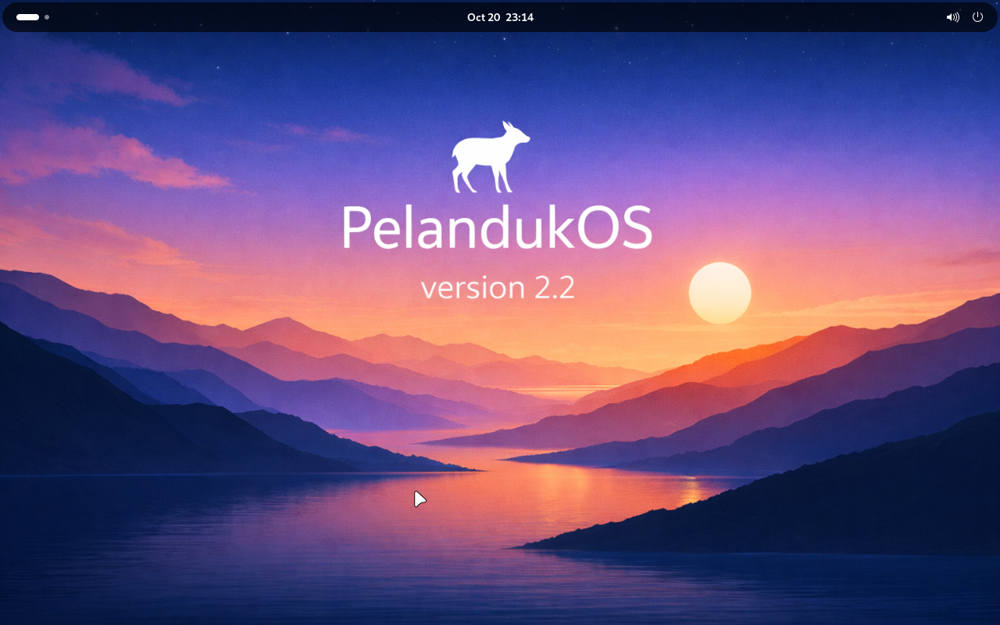

# Development validation — 2026-10-20

## Live editing and packages

Full unprivileged suite: **98 passed, 6 skipped** in 41.18 seconds.
The skipped cases are four opt-in ISO BIOS/UEFI tests, the full real-ISO test,
and the root-only APT integration. They are not counted as passes.
Final package-metadata/GUI follow-up: **10 passed** in 0.81 seconds.
Privileged APT integration also passed separately after stream handling changes.

New integration coverage includes:

- Real no-ISO QEMU boot, command execution and persisted file contents/modes.
- Real framebuffer capture and a keyboard event read from guest evdev
  (`EV_KEY`, `KEY_A`, pressed), rather than merely accepting a QMP request.
- Confined-worker live session, frame/control forwarding, clean process exit and
  interrupted live-state recovery.
- Atomic package commit/restore, failure cleanup, incomplete-copy detection,
  kernel-change refusal and package-name/metadata validation.
- A locally built `.deb`, target repository refresh, dependency simulation,
  real APT/dpkg install/remove, numeric root ownership and rollback. These
  operations use a generated guest root, never host APT/repositories.

The actual extracted PelandukOS project was also booted with a **read-only 9p
export plus a guest RAM overlay**, without generating an ISO or editing the
project contents. The host bootstrap kernel was `7.1.13+deb14-amd64`.
GNOME's `gdm-wayland-session` and desktop started. A mouse click dismissed the
welcome window; Escape left overview. QMP powerdown completed normally with
`forced: false` after approximately 57 seconds including timed input checks.



The existing `0040-pelandukos` live-config hook initially stalled on early
`dbus-launch gsettings`. Editor boot now selects only standard user/login
components. The source hook and ISO boot configuration are not rewritten.
Missing guest evdev/HID/ACPI button modules were detected during input testing
and added to the bootstrap.

X11 was not tested separately. Neither the host-kernel session nor these
synthetic tests establish rebuilt-ISO BIOS/UEFI, installer, Secure Boot or USB
boot acceptance. Persistent edits were verified in writable synthetic sessions;
the real user's desktop check deliberately used a non-mutating overlay.

## Earlier metadata and ISO workflow validation

Previous targeted metadata fix: **27 passed** in 5.07 seconds:
`tests/test_desktop.py`, `tests/test_gui.py`, `tests/test_safety.py`.
The installed pre-fix Desktop Customizer reproduced the exact
`File exceeds the text editor limit (2048 KiB)` exception with a 2,880,000-byte
synthetic dpkg status file. Desktop detection now uses a bounded streaming reader
instead of the text editor's reader. Tests include databases above 2 MiB in both
native and confined inspect/apply/rebuild/reopen paths, unchanged editor limits,
oversized/malformed metadata, CRLF/EOF records, continuation fields, removed
packages and host symlink refusal. Boot code is unchanged; VM tests were not
repeated for this metadata-reader fix.

Previous full result with ISO boot tests enabled: **88 passed, 1 failed, 1 skipped** in 120.22 seconds, after
the step-based UI and offline desktop customization. The failed non-APM UEFI case
timed out at 90 seconds; the exact unchanged ISO passed an immediate repeat boot
in **4.29 seconds**. This is recorded as an intermittent failure, not a clean
full-suite pass. The preceding progress/version run had 81 passes and one skip.

Command:

```bash
PELANDUKOS_BOOT_KERNEL=/boot/vmlinuz-7.1.13+deb14-amd64 \
  /tmp/pelandukos-dev-venv/bin/python -m pytest -q -ra
```

The skipped test was `tests/test_real_iso.py`: the opt-in environment variable for
full privileged real-ISO acceptance was not set. It is not counted as a pass.

## Guided UI and desktop customization

The final targeted run passed **13 tests** in 4.62 seconds:
`tests/test_desktop.py` and `tests/test_gui.py`.

- Real GNOME schema compilation and memory-backend `gsettings` readback.
- Native and confined import → desktop apply → rebuild → reopen workflows.
  The rebuilt ISO is extracted and its wallpaper bytes and schema override are
  explicitly read back from the new SquashFS.
- Correct KDE/Plasma and XFCE configuration formats; unrelated values retained.
  Plasma revisions get sequential filenames for once-per-user update handling.
- Unsupported fields/themes, invalid font input, image format refusal,
  symlink escapes, confirmation requirements and missing compiler detection.
- Configuration backup permissions, compile-before-write failure and rollback
  after a partial write failure.
- Six steps plus Settings, dependency gating, enabled desktop controls and dirty
  choices. Palette tests check child text and list colors after live dark/light
  palette changes, not just the top-level window background.
- Light/dark offscreen renders were visually inspected. Desktop sessions themselves
  have not been booted for appearance acceptance.

The unchanged UEFI retry ISO SHA256 was
`a5c658657ba7ff4eefa6666eeae8c3116fdfa7fa8c2790f488501f88ee616589`.
All four synthetic boot cases reached the guest marker across the full run and
the retry. A similar non-APM UEFI transient occurred in an earlier milestone;
its cause is still unconfirmed. No boot-engine changes were made for this UI work.

## Measured progress follow-up

The full suite includes actual copying/checksumming byte counts, chunked container
allocation, allocation failures, fragmented/backspace tool output, old-tool flag
fallback and a real 128 MiB ext4 format reporting inode-table percentages.
Confined import/build/export tests verify that progress events reach the caller.
Offscreen GUI tests verify numeric progress, GiB counts, elapsed time, transitions
to unmeasured stages and failure/success completion states.
After adding progress to payload/MD5 readback and wrapping the status text,
all **20 affected GUI, progress, native and confined round-trip tests** passed
again in 5.32 seconds. The offscreen rendered status bar was visually checked.

All four synthetic BIOS/UEFI boot cases passed with the updated xorriso progress
option. The tests do not establish a percentage or ETA for an existing job started
with the previous silent formatter, nor qualify a real desktop ISO.

## Custom version follow-up

After adding release-version inputs, **28 related tests passed** in 7.30 seconds:
`tests/test_gui.py`, `tests/test_projects.py`, `tests/test_integration.py`,
`tests/test_image_storage.py` and `tests/test_storage.py`.
They verify version persistence, rejection of invalid versions before project
creation, native/confined build metadata, exported release JSON, synchronized
GUI fields and preservation of manually entered ISO filenames. Boot code was
unchanged; VM boot tests were not repeated for this metadata/UI change.

## exFAT container follow-up

An explicit Polkit test created a 512 MiB fixture container on the actual
“One Touch” exFAT drive. It imported a synthetic Debian Live ISO, edited a file,
changed ownership to 1234:2345, reopened the project, rebuilt and exported four
release artifacts, moved to native Linux storage, and moved back to the container.
The source ISO checksum stayed unchanged. Private mounts and loop devices were
absent after the jobs completed. All generated test files were removed.

Additional automated tests cover bounded capacity, allocation fallback and ENOSPC,
container UUID/size validation, confined engine import/edit/build/export/reopen,
host symlink refusal, isolated copy/cleanup, and refusing recursive cleanup after
an unmount error. The GUI test accepts exFAT and exposes container capacity.

The exFAT integration is opt-in and uses a small synthetic ISO, not the user's
large desktop ISO. Large-container allocation time, power-loss recovery and full
desktop/installer qualification still require testing. The four BIOS/UEFI boot
tests in the normal suite use native temporary project storage.

## Storage selection follow-up

New tests exercise selected-folder creation/reopening, legacy storage, project
listing when a drive disappears, marker substitution, symlink rejection, pinned
directory access after rename, unsupported filesystems, GUI submission, and
failed/corrupt copies retaining the original. A real-tool integration imports,
edits, relocates, rebuilds with ISO payload readback, and moves back to the default
store while preserving rootfs contents, ownership, modes, links and xattrs.
Sandbox inputs/outputs now use inherited bind descriptors; the suite also checks
that the parent closes those descriptors after each invocation.

## Hybrid-APM follow-up

The installed application rejected the user's real
`pelandukosv2-amd64-gnome-2026.03.03.iso` because the first adapter rejected every
APM. Its recorded source SHA256 is
`a918458fbe3fe462f8fed29f6d8b2a1ddfdf5547e6d592fc22e72352e84a281d`.

Read-only inspection confirmed an ISOLINUX MBR/GPT/APM hybrid whose APM entry,
GPT entry, MBR EFI entry and El Torito UEFI image all expose the same EFI payload.
The xorriso replay report explicitly includes both `gpt_basdat` and `apm_hfsplus`.
The boot reports are retained in `tests/fixtures/pelandukos-hybrid-apm.json`.

Added checks cover acceptance of that exact report, rejection of unrelated or
inconsistent mappings, APM loss during rebuild, and false architecture matches
in volume labels. Both BIOS and UEFI boot tests now run against synthetic
MBR/GPT and MBR/GPT/APM ISOs. The full final run passed all four boot cases.
One earlier non-APM UEFI run timed out; the identical ISO passed an unchanged
repeat boot in 4.3 seconds. The cause of that transient timeout is unconfirmed.

The real image's 371,215-inode SquashFS was also listed read-only using its
verified contiguous ISO extents. The size reducer processed 449,197 listing
records without retaining them in memory, yielding an estimated 28,956,363,117
rootfs bytes. Four additional tests cover streaming output beyond 16 MiB,
chunked listing records, malformed listings and streamed command failures.

The current extraction check requires approximately **57.29 GiB free before
ISO-tree extraction**, including reserved build/readback space. The project-store
filesystem had only **30.23 GiB free**. The full real-image import was not retried,
and no disk-space guard was weakened.

## Environment

- Python 3.14.8; PySide6 6.12.0 in a temporary development virtual environment.
- xorriso 1.5.8.pl02; squashfs-tools 4.7.5; bubblewrap 0.13.0.
- QEMU 11.1.2; KVM available; matching OVMF 4M firmware available.
- Source checkout on exFAT; test project filesystems on `/tmp` tmpfs.
- These tool versions are newer than Debian 12/13 baselines. Testing on those
  target host releases is still required.

## Observed results

- Real xorriso/SquashFS import → edit → rebuild → extraction/readback round trip.
- Source ISO checksum unchanged; generated ISO SHA256 matches release metadata.
- Text content, numeric test-user ownership, permission mode, user xattr,
  hardlinks and symlinks survived the tested operations.
- Rebuilt synthetic BIOS ISO reached `PELANDUKOS_SYNTHETIC_BOOT_OK`.
- Rebuilt synthetic UEFI ISO reached the same guest marker under OVMF.
- QMP embedded-preview test received a framebuffer and removed its temporary
  workspace after stopping QEMU.
- Offscreen Qt construction, sidebar pages and both themes passed.
- Path traversal, symlink escapes, special-file reads, overwrite protection,
  insufficient-space checks, project locking and interrupted-job recovery passed.
- An injected compressor failure retained the saved edits and removed staging.
- Same-version kernel-module edits are detected by the build guard.
- Ruff, Python compilation, desktop-file validation and Polkit XML parsing passed.

The synthetic VM initramfs prints a success marker and powers off. It does not
mount the edited SquashFS or launch a Debian desktop. SquashFS edits are checked
separately by the ISO readback test.

## Remaining acceptance

The root-owned package/helper has since been installed at the user's request,
and its read-only project RPC has been verified through Polkit. Arbitrary UID/GID,
POSIX ACL, file capability and device-node restoration still need privileged
acceptance. Only the application package was installed; host repositories and
unrelated system packages were not changed.

The host's system PySide6 installation lacked QtWidgets; the working test
runtime was installed only into `/tmp/pelandukos-dev-venv`.

No real desktop, installer, persistence, Secure Boot or USB-hybrid behavior is
qualified by this report. See [VALIDATION.md](VALIDATION.md).
